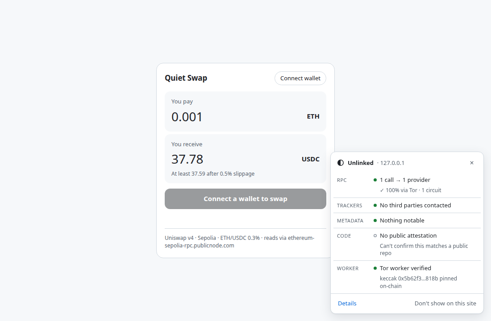

# Unlinked

**A browser extension that, on every dapp you open, shows what the app leaks, checks its code against public builds, and sends its RPC reads through [anon-rpc](https://ethereum.github.io/anon-rpc/).**

No wallet switch, no dapp changes, no Unlinked server.



- **Protect:** the JSON-RPC reads a page sends with `fetch` go through Tor via an anon-rpc worker, with one circuit per site and per account. The provider sees neither your IP nor which accounts belong together. The card shows how much was protected.
- **See:** shows which third parties the page contacts, and which ones received your wallet address.
- **Verify:** hashes the scripts the page ran and checks them against [Arkiv](https://arkiv.network) attestations. A swapped or injected script turns the badge red.

## Run it

```sh
npm install
npm run build
```

1. Chrome → `chrome://extensions` → Developer mode → **Load unpacked** → `packages/extension/dist/unpacked`
2. `npm run dev -w @unlinked/quiet-swap` opens the demo dapp, a Uniswap v4 swap on Sepolia, at http://localhost:5173

## Test it

```sh
npm test                                              # unit tests
npm run e2e                                           # the extension in Chromium, end to end
NETWORK=tor node packages/extension/test/live.mjs     # real Tor + real Sepolia + real Arkiv
```

Browser tests need `npx playwright install chromium`, or `CHROME_PATH` set to a Chrome binary.

## Other tools

```sh
npm run spy                                                    # logging RPC proxy: shows what a provider learns about callers
npm run verify -- packages/extension/dist/unlinked-0.1.0.zip   # check a build against Arkiv
PRIVATE_KEY=0x… npm run attest -- --dir packages/quiet-swap/dist --kind frontend \
  --name quiet-swap --repo github.com/nullllllion/unlinked --commit "$(git rev-parse HEAD)"   # publish a build (needs test GLM)
```

## CROPS

- **C:** No Unlinked server. The anonymity network, the Arkiv node and the attesters are all replaceable, and the extension installs from a reproducible zip.
- **O:** MIT. `npm ci && npm run build` reproduces the release zip byte for byte.
- **P:** For routed calls, the RPC provider sees Tor exits, never your IP, two of your accounts in one request, or the page's ids. Unlinked keeps everything about you on your device.
- **S:** Never touches keys. The worker is hash-pinned and sandboxed. A green check needs attesters you chose.

## Arkiv

Build attestations go on Tiramisu (chain `7738577`). None have been published yet.

```
project = str('unlinked') AND type = str('build') AND root = bytes32(0x…)
```

## Limits

- **Not every read can be protected.** A dapp's own endpoint that refuses anonymous calls gets them directly, since it already knows your IP from the page load. In a page-load test of six dapps with no wallet connected, ENS, Lido, Curve and CoW Swap were 100% protected, Revoke.cash routed 22 of 34 calls while 12 failed, and Uniswap's web app was 0%. The card shows the real number.
- **Your wallet's own traffic isn't covered.** Anything sent through your wallet uses its RPC, because one extension can't intercept another. WebSockets and XHR aren't intercepted either.
- **Only static scripts are verified.** Inline scripts can't be checked, and cross-origin files without CORS are reported as unreadable.
- **The default Tor gateway is the Ethereum Foundation's demo,** with limited capacity.
- **Chromium only so far.**

## How AI was used

_Describe it here before submitting, as ETHGlobal's rules and Arkiv's tracks require._

## License

MIT
